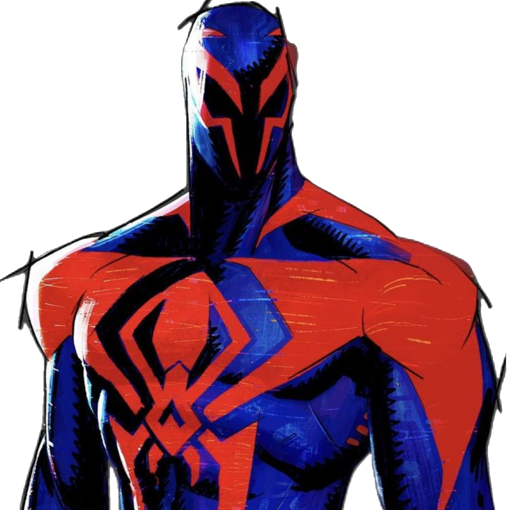

<!--gay-->
 

 ⠀⠀  ⠀ ⠀ ⠀  ⠀⠀  ⠀⠀ ⠀ ⠀ 

  

$\color{#E60000}\text{SM2099ㅤbigㅤ enthusiastㅤ}$  

${\color{#A89DFA}𝐬\color{#C9C3FA}𝐩\color{#E0DCFA}𝐢\color{#F1F0F7}𝐝\color{#E0DCFA}𝐞\color{#C9C3FA}𝐫 \color{#C9C3FA}𝐯\color{#A89DFA}𝐞\color{#C9C3FA}𝐫\color{#E0DCFA}𝐬\color{#F1F0F7}𝐞}$  $\color{#FF0011}\text{ㅤfans ff2 int }$ 

ㅤ

ㅤ

ㅤ

ㅤ

  
  

<table>
<tr><td align="center">

<table>
<tr><td align="center">
  
  ${\color{#9C0008}𝐏\color{#9C0008}𝐨\color{#CC000A}𝐧\color{#ED000B}𝐲 \space \color{#F70C17}𝐓\color{#ED000B}𝐨 \color{#CC000A}𝐰\color{#9C0008}𝐧\color{#6E0005}𝐬 \space \color{#9C0008}𝐌\color{#CC000A}𝐢\color{#ED000B}𝐠 \color{#F70C17}𝐮\color{#ED000B}𝐞\color{#CC000A}𝐥 \space \color{#9C0008}𝐎 \color{#6E0005} 𝐇\color{#9C0008}𝐚\color{#CC000A}𝐫\color{#ED000B}𝐚}$

</td></tr>
</table>

  thanks y'all im so happy rn 

  
  [marvelous pt](https://github.com/marvelous-pt) ⠀⠀ [pt everypony](https://github.com/pt-everypony) ⠀⠀ [knox event](https://github.com/Knox-Event) ⠀⠀ [the tempist](https://github.com/THE-TEMPIST) ⠀⠀ [fans town](https://github.com/fans-town) ⠀⠀ [pt walk of fame](https://github.com/pt-walk-of-fame) ⠀⠀ [pt hall of media](https://github.com/pt-hall-of-media) ⠀⠀ [pt of awesomeness](https://github.com/pt-of-awesomeness) ⠀⠀ [pt contributers](https://github.com/pt-contributers) ⠀⠀ [title town](https://github.com/title-town) ⠀⠀ [pt fashion](https://github.com/pt-fashion) ⠀⠀ [pony achievements](https://github.com/ponychievements) ⠀⠀ [characters of pt](https://github.com/charactersofpt) ⠀⠀ [pony town nominations](https://github.com/ponytown-nominations) ⠀⠀ [pt medals](https://github.com/pt-medals) ⠀⠀ [folktown](https://github.com/FOLKTOWN) ⠀⠀ [pt rewards](https://github.com/Ponytowns-rewards) ⠀⠀ [music town](https://github.com/music-town) ⠀⠀ [pt piddles.jet](https://github.com/piddlesjet) ⠀⠀ [pony honors](https://github.com/Ponyhonors) ⠀⠀ [pt dagger](https://github.com/daggerstruckmage) ⠀⠀ [pt nominations](https://github.com/pony-town-nominations) ⠀⠀ [creepy town](https://github.com/creepy-town-hall) ⠀⠀ 

</td></tr>
</table>

